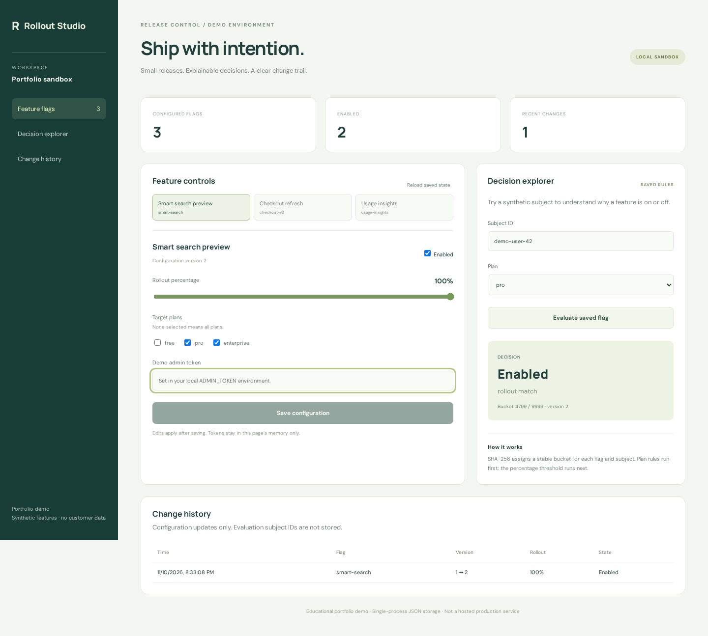
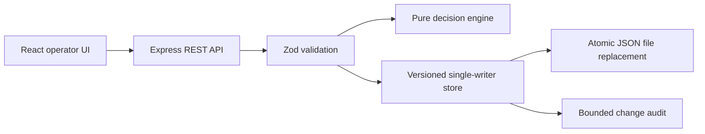

# Rollout Studio — feature flag control plane

[](https://github.com/DatadrivenAlex/feature-flag-control-plane/actions/workflows/ci.yml)

A runnable TypeScript + React portfolio demo of safe incremental feature releases: plan targeting, stable percentage rollouts, a decision explorer, optimistic concurrency and a bounded audit trail.

> New educational project created for this portfolio. Synthetic features and subjects only. It is not previous client work, an employment deliverable, or evidence of production adoption. Review the code and limitations before reuse.



## Why this project

Feature flag systems combine backend correctness with a useful operator UI. This demo focuses on a small, complete vertical slice rather than claiming a distributed production platform. It complements Python/API and AI projects with **TypeScript, React, Express, REST APIs, runtime validation, persistence, tests, Docker and CI**.

## Run in three minutes

Requires Node.js 24 and npm. No paid keys, model, database service or account needed.

```bash
npm ci
npm run build
ADMIN_TOKEN=local-demo-token-123 npm start
# Open http://localhost:3000
```

The example token is intentionally public, for a local demo only. Enter the same value in the UI's token field. Do not enter a real credential. To use Docker instead:

```bash
ADMIN_TOKEN=local-demo-token-123 docker compose up --build
```

Compose binds only to localhost. State is kept in `data/state.json` (or the Docker volume). Deleting that local file resets the synthetic fixtures. For UI development, run the API above and `npm run preview` in a second terminal; Vite proxies `/api` to port 3000.

## Five-minute review

1. Select **Smart search preview**, set rollout to 100%, enter the demo token and save.
2. Evaluate `demo-user-42` with the `free` plan: `plan_not_targeted`.
3. Change the plan to `pro`: `rollout_match`.
4. Set rollout to 0%, save and evaluate again: `outside_rollout`.
5. Inspect change history, then restart the process: configuration and audit survive.
6. Use two browser tabs to save stale versions: the second save returns HTTP 409 instead of silently overwriting the first.

The explorer evaluates **saved** server configuration, not unsaved form edits. Its bucket is in `[0,9999]`; a 35% rollout matches buckets `<3500`. SHA-256 is deterministic but finite cohorts need not have exactly the configured percentage. Plan targeting always precedes rollout. Disabled/missing flags fail closed. Flag and subject are hashed as a JSON tuple to avoid ambiguous concatenation.

## Architecture



- `src/engine.ts`: validation, deterministic buckets and decision reasons.
- `src/store.ts`: defensive copies, stale-write rejection, state-file persistence.
- `src/app.ts`: HTTP boundaries, exact demo admin-token check and error handling.
- `web/`: responsive UI, password-type token field, in-memory token only, server errors.
- `tests/`: engine, API and persistence tests.
- `e2e/`: browser workflow and mobile overflow checks.

## API

| Method | Path | Purpose |
|---|---|---|
| GET | `/api/health` | Demo liveness |
| GET | `/api/flags` | Saved feature configuration |
| POST | `/api/evaluate/:key` | Evaluate `{ "subject":"demo-user-42", "plan":"pro" }` |
| PUT | `/api/flags/:key` | Admin-token-protected update; send entire flag including current `version` |
| GET | `/api/audit` | Last 50 configuration changes, newest first |

`PUT` expects `Authorization: Bearer <local demo token>`. It increments `version`; stale writes return 409. Only seeded flags can be edited; creation/deletion are deliberately out of scope. Context attributes are strictly validated, never logged or persisted by the app. Evaluation output contains only decision, reason, configuration version and numeric bucket.

## Verification

```bash
npm test                 # 24 engine/API/persistence tests
npm run build            # strict type-check + Vite production build
npx playwright install chromium
npm run test:e2e         # desktop operator flow + mobile layout
```

CI runs these checks on Node 24. Playwright uses isolated temporary state and a synthetic demo token. The screenshot is from the running app, not a mockup.

## Honest limits and security boundaries

- Single process, single writer. JSON replacement is not a distributed transaction or an fsync durability guarantee. Use a transactional database and migration strategy for concurrent replicas.
- One shared local admin token is **not** OAuth, RBAC, user identity, session management or a production authorization design. Audit records are change events, not verified human identities.
- No rate limiting, TLS termination, tenant isolation or managed secrets; do not expose this demo to the public internet. Public read endpoints reveal synthetic configuration and audit only.
- Audit retains the last 1,000 events in the file and exposes the last 50. This is not an immutable compliance log.
- Buckets are not encryption or anonymization. Use synthetic identifiers only. There is no experiment attribution, statistical analysis, SDK cache, streaming update or remote evaluation guarantee.
- Automated UI checks cover two happy-path/layout cases, not a full accessibility or security audit. UI uses semantic controls and keyboard focus indicators.
- Docker configuration is supplied; Docker build is not part of the local verification when no Docker daemon is available.

## License

MIT. See [LICENSE](LICENSE).
